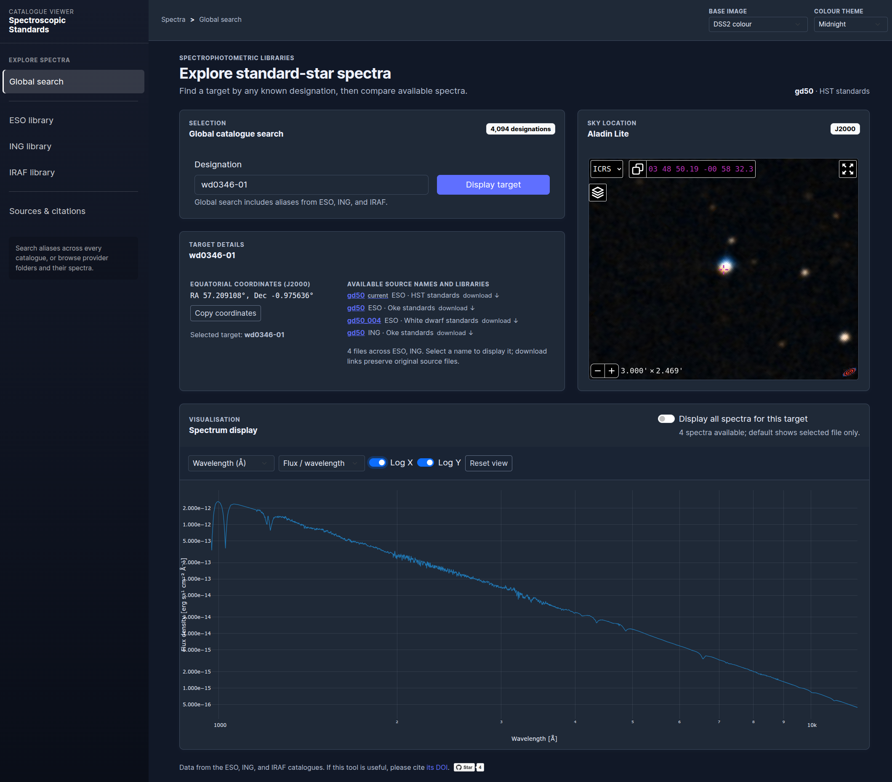

# SpectroscopicStandards

SpectroscopicStandards is a browser-based viewer for spectrophotometric standard-star spectra from the ESO, ING, and IRAF catalogues. Search by designation, browse each provider folder, compare available spectra, inspect a finder chart, and download the original data files.

The **Sources & citations** tab gives one line per data folder of the relevant publication and links each reference to its NASA ADS abstract.

The webpage generated from the scripts in this repository can be found at:
<https://cylammarco.github.io/SpectroscopicStandards/>



If you have made use of this tool, we would appreciate if you could reference <https://zenodo.org/record/7978970>.

In version 2 (10 August 2026), we have made use of ChatGPT 5.6 Terra.

## Web data

The viewer uses `spectra-index.json` for designation, provider, coordinate, and
download metadata. It is built directly from each file's aliases, so multiple
spectra in one provider folder are retained for comparison.

When changing source files or aliases, first regenerate the two committed metadata inputs:

```bash
python generate_dictionary.py
```

Then rebuild the browser index and compressed spectrum assets:

```bash
node scripts/build-web-data.mjs
```

This writes a compressed index and `.gz` copy of every plain-text spectrum. The
browser loads these gzip assets where `DecompressionStream` is available and
falls back to the plain text file otherwise. Original files remain in place
for the download links in the interface.
